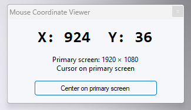

# Mouse Coordinate Viewer

## Project purpose

**Mouse Coordinate Viewer** is a lightweight Windows utility that displays the mouse pointer's X and Y screen coordinates in real time. It helps developers identify precise screen positions for coordinate-based desktop automation.

Typical use cases include virtual mouse and keyboard workflows, automated clicking, file and folder drag-and-drop workflows, repetitive desktop tasks, and user interface testing. It can help locate button positions, cursor movement targets, and the start and end points of drag operations.

**Important:** The application does **not** perform automated clicks, keyboard input, or file transfers itself. It provides coordinate information that can be used when building those automation tools.

### Use cases

- **Mouse and keyboard automation:** Identify pointer movement and click targets.
- **File and folder workflows:** Find start and destination points for screen-based drag-and-drop operations.
- **Desktop automation:** Map interface control points for repetitive tasks.
- **UI testing:** Inspect the locations of buttons, menus, and other interface elements.
- **Learning and development:** Explore screen coordinate systems and prototype automation workflows.

**Technical note:** Coordinates may change with display resolution, window positions, display scaling, or multi-monitor layout. Coordinate-based automation should account for these changes.

## Application screenshot

**Language:** This is the English documentation. [Türkçe ana sayfaya dön / Back to Turkish](README.md).

## Features

- Displays live mouse X/Y coordinates.
- Keeps its window always on top.
- Detects primary monitor resolution automatically.
- Moves the pointer to the primary monitor's center using the **Center on primary screen** button.
- Uses physical pixel coordinates under Windows display scaling.
- Does not require an installer or administrator privileges.

## Download and run

The prebuilt `MouseCoordinateViewer.exe` has **not yet been published in this repository**. Once uploaded, download it and run it on Windows. The cursor moves to the center of the primary screen at startup. Moving the mouse updates the coordinates, and closing the window exits the application.

## Build from source

1. Select **Code → Download ZIP** and extract the repository.
2. On Windows, run `build.cmd`.
3. If compilation succeeds, `MouseCoordinateViewer.exe` will be created.

Requires Windows and the .NET Framework 4.x C# compiler. Visual Studio is not required if the compiler is installed.

## Example coordinates

On a 1920 × 1080 primary display, the center is **X: 960, Y: 540**. On a 1280 × 1024 display, it is **X: 640, Y: 512**. Coordinates may be negative when multiple monitors are connected.

## Project files

| File | Description |
|---|---|
| `MouseCoordinateViewer.cs` | C# application source |
| `MouseCoordinateViewer.manifest` | Windows manifest and DPI configuration |
| `build.cmd` | Windows build script |
| `.gitignore` | Git ignore rules |
| `README.md` | Turkish primary documentation |
| `README_EN.md` | English documentation |

## Verification

The English-interface build was previously reported to compile, and the original build passed a basic cursor-reading and screen-center self-test. The graphical interface has not been visually verified on Windows. This repository does not include an automated test suite.

## Security and behavior

The application moves the pointer on startup and when the center button is pressed. It does not click, modify files, or request administrator privileges.

## License

No license file has been added yet. A license should be selected to clarify permission to use, modify, and redistribute the project.
